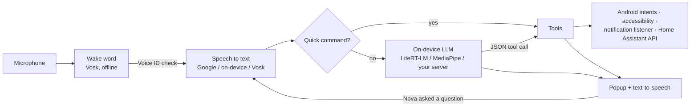

# Nova — a private, on-device voice assistant for Android

Nova is an Android voice assistant with a **wake word you choose**. It runs a **local AI model on the phone** to handle anything you ask, and it can control your phone, your apps and your **Home Assistant** smart home.

Say the wake word and a small popup slides up from the bottom of the screen. It shows what you said, Nova's spoken reply, and a box to keep the conversation going by voice or by typing. To close it, swipe it down, tap ✕, press back or tap outside; closing it stops every sound Nova was making.

Speech recognition for the wake word, the AI model, Voice ID and the device controls all run on the phone. Nova only goes online for what you ask it to reach: your Home Assistant server, the weather service, the AI-model downloads, or an AI server you choose to use instead of the phone.

> **Status:** personal project, under active development, built and tested on a OnePlus phone (Snapdragon 8 Elite, Android 16). There are no prebuilt APKs yet, so you build it from source (see [Build & install](#build--install)).

---

## Contents

- [Highlights](#highlights)
- [What you can say](#what-you-can-say)
- [How it works](#how-it-works)
- [Requirements](#requirements)
- [Build & install](#build--install)
- [First-run setup](#first-run-setup)
- [Choosing an AI model](#choosing-an-ai-model)
- [Wake word & Voice ID](#wake-word--voice-id)
- [Personal index](#personal-index)
- [Custom words](#custom-words)
- [Home Assistant](#home-assistant)
- [Music, apps & the web](#music-apps--the-web)
- [The popup](#the-popup)
- [Ways to start Nova](#ways-to-start-nova)
- [Staying alive in the background](#staying-alive-in-the-background)
- [Settings reference](#settings-reference)
- [Privacy & security](#privacy--security)
- [Troubleshooting](#troubleshooting)
- [Known limitations](#known-limitations)
- [Development](#development)
- [Credits & licenses](#credits--licenses)

---

## Highlights

- **Any wake word.** Type a phrase ("hey nova", "computer", "okay jarvis") and add sound-alike variants. Nova listens for it offline with [Vosk](https://alphacephei.com/vosk/). A live test panel shows exactly what it hears.
- **Voice ID.** Record your voice once and Nova only wakes up for you. It compares a speaker embedding against your saved voiceprint, offline.
- **On-device AI.** Nova runs models like Gemma 4, Qwen 3/3.5 and LFM 2.5 on the phone's GPU with Google's [LiteRT-LM](https://github.com/google-ai-edge/LiteRT-LM). You get one-tap downloads, or you can import your own `.litertlm` / `.task` file, or point it at your own server (Ollama, llama.cpp, LM Studio).
- **About 60 tools.** Timers, alarms, reminders, calls, texts, WhatsApp, notification replies, volume, brightness, Wi-Fi/Bluetooth/airplane mode, apps, music, maps, web search, calendar, weather, screen reading and tapping, screenshots, memory, notes, and Home Assistant.
- **Instant quick commands.** Common requests ("set a timer for 10 minutes", "volume to 40%", "call mom") are understood without waiting for the AI, so they're instant and work even with no model installed.
- **Home Assistant built in.** Sign in once. The devices behind your Home Assistant home-screen widgets become Nova's main devices. Opening doors or unlocking asks you to confirm first.
- **Uses every Android hook it can.** It runs as an accessibility service, as a foreground microphone service with a persistent notification, and as the default digital assistant (long-press home / corner swipe). It also offers Quick Settings tiles, a launcher shortcut and the headset button.

## What you can say

| Area | Examples |
|---|---|
| **Clock** | "set a timer for 10 minutes", "pasta timer for 8 minutes", "how much time is left", "wake me up at 6:30", "set an alarm for 7 every weekday", "cancel my 7am alarm", "when's my next alarm", "remind me to call mom tomorrow at 5" |
| **Calls & messages** | "call mom", "call back", "who called me", "text Sam I'm running late", "send a WhatsApp to Alex saying on my way", "read my texts", "email Jordan about the meeting" |
| **Notifications** | "read my notifications", "reply to Jane saying sounds good" (works in any app that has a reply button), "clear my notifications" |
| **Volume & media** | "volume up", "turn it down a little", "set the volume to 30", "set it to 50%" (right after a volume change), "ringer volume to 40", "mute", "pause the music", "next song", "what song is this" |
| **Music** | "play spotify", "play jazz", "play daft punk", "play my workout playlist", "play bohemian rhapsody on spotify", "play lofi on youtube" |
| **Phone settings** | "turn on wifi", "bluetooth off", "airplane mode on", "turn on the flashlight", "brightness to 30%", "dim the screen", "do not disturb on", "put my phone on vibrate", "dark mode on", "open battery settings" |
| **Screen** | "what's on my screen?", "summarize this page", "tap sign in", "type hello there", "scroll down", "go back", "go home", "lock the phone", "take a screenshot" |
| **Apps & web** | "open spotify", "search for best pizza near me", "go to wikipedia.org", "navigate to the airport", "walking directions to the park", "coffee near me", "take a selfie" |
| **Info** | "what time is it", "what's the date", "what's 15% of 80", "weather tomorrow", "will it rain this weekend", "where am I", "what's next on my calendar", "what's on my calendar today", "add dentist Friday at 3pm", "how much battery do my AirPods have" |
| **Your stuff** | "directions to my dentist appointment", "what time is the party Sam texted about", "what was that code from the bank" (via the personal index) |
| **Smart home** | "open the garage", "turn off the kitchen light", "set the bedroom light to 40%", "set the thermostat to 70", "run movie night", "lock the front door", "is the humidity switch on?", "turn off the living room lights" (passed to Home Assistant Assist) |
| **Memory** | "remember my locker code is 4312", "what do you remember about me", "forget the locker code", "take a note buy milk", "read my notes" |
| **Anything else** | Questions, explanations, writing, translations, follow-ups: the on-device model answers them and keeps the conversation going while the popup is open |

## How it works



1. **Wake word.** A foreground service keeps a tiny Vosk recognizer listening for your phrase. In *Precise* mode it only listens for the phrase itself and uses very little battery. In *Free speech* mode it transcribes everything and fuzzy-matches the phrase, which works for made-up names and lets you say the command in the same breath.
2. **Voice ID (optional).** The last couple of seconds of audio are compared against your voiceprint, and anyone else is ignored.
3. **Speech to text.** Nova uses Android's recognizer (Google, or on-device on Android 12+). It falls back to fully offline Vosk if that fails.
4. **Quick commands** handle common requests instantly with deterministic rules.
5. **The LLM** gets a system prompt listing every enabled tool and your Home Assistant devices. It replies with one JSON object, either `{"tool": …, "args": …}` or `{"say": …}`. Nova runs the tool, feeds the result back if the model needs to summarize it, and speaks the answer. LiteRT-LM keeps the conversation's KV cache between turns, so follow-ups are fast.
6. **Tools** act through Android intents, system APIs, the accessibility service (for things apps aren't allowed to do directly), the notification listener, and Home Assistant's REST API.

More detail: [docs/ARCHITECTURE.md](docs/ARCHITECTURE.md).

## Requirements

**Phone**
- Android 8.0+ (API 26). Developed and tested on Android 16.
- 64-bit ARM (`arm64-v8a`). The build only includes arm64 native libraries.
- RAM: 6 GB+ for the small models, 8 GB+ recommended for Gemma 4 E2B, 12 GB+ for Gemma 4 E4B.
- Storage: ~40 MB for the wake-word model and ~14 MB for Voice ID, plus 0.3–3.5 GB for an AI model.

**Build machine**
- JDK 21 (the Gradle wrapper downloads Gradle 8.14).
- Android SDK with platform 36 and build-tools 35+. Set `sdk.dir` in `local.properties` or `ANDROID_HOME`.

## Build & install

```bash
git clone https://github.com/ezeren76neptune/nova-assistant.git
cd nova-assistant
echo "sdk.dir=$HOME/Android/Sdk" > local.properties   # wherever your SDK lives
./gradlew assembleRelease
adb install -r app/build/outputs/apk/release/app-release.apk
```

- The release build is signed with your local **debug** key, which is fine for sideloading. Use your own `signingConfig` for anything else.
- To build for an x86_64 emulator: `./gradlew assembleDebug -Pabis=x86_64`.
- **Install over USB with `adb` if you can.** Android 13+ blocks accessibility and notification access for apps installed from a downloaded APK ("Restricted setting"). Installing with adb avoids that. If you sideloaded the APK, open App info → ⋮ → **Allow restricted settings** first.

## First-run setup

Open Nova. The home screen has a **Setup checklist**; tap **Fix** on each item.

1. **Grant all permissions:** microphone, notifications, contacts, phone, SMS, calendar, location.
2. **Wake-word model:** downloads automatically (40 MB, English). For other languages, change the model URL under Wake word.
3. **AI model:** go to AI model and tap **Download** on a model (see below), then **Use**. Nova still works without one, but only for quick commands.
4. **Accessibility service:** Settings → Accessibility → Installed apps → **Nova Assistant** → On. This is needed for screen reading, tapping, the toggle tricks, auto-pressing Send, Spotify playback, and the overlay popup.
5. **Notification access:** for reading and replying to messages, and for media control and "what song is this".
6. **Default digital assistant:** set it to **Nova**. This turns on long-press home / corner swipe and is the strongest keep-alive.
7. **Battery → Unrestricted.** Also see [Staying alive](#staying-alive-in-the-background) for phone-maker specific steps.
8. *Optional:* modify system settings (brightness, rotation), Do Not Disturb access, exact alarms, display over other apps.
9. **Set your wake word** under Wake word, and say it while watching the live test panel.

## Choosing an AI model

All of these download in-app straight from Hugging Face (`litert-community`). The **(GPU)** builds use the phone's GPU (OpenCL) and fall back to the CPU automatically.

| Model | Size | Notes |
|---|---|---|
| **Gemma 4 E2B (GPU)** | 2.3 GB | Recommended. Best tool use and answers for the size. 8 GB+ RAM. |
| Gemma 4 E4B (GPU) | 3.3 GB | Smarter, slower. 12 GB+ RAM. |
| Qwen 3.5 2B (int8) | 2.1 GB | Strong all-rounder. |
| Qwen 3 4B Instruct 2507 (int4) | 2.7 GB | Good reasoning; heavier. |
| Qwen 3 1.7B (int4) | 1.0 GB | Mid-range phones. |
| Qwen 3.5 0.8B (GPU) | 0.9 GB | Fast; fine for simple requests. |
| LFM 2.5 1.2B Instruct (GPU) | 0.7 GB | Fast and light. |
| Qwen 3 0.6B (int4) | 0.3 GB | Tiny; mostly for quick-command fallbacks. |
| Gemma 3 1B (int4) | 0.6 GB | Gated on Hugging Face, so it needs an HF token (set it in AI model). |
| Qwen 2.5 1.5B (`.task`, MediaPipe) | 1.6 GB | Older MediaPipe format. |

Other options:
- **Your own file.** Use **Import model file…** for any `.litertlm` (LiteRT-LM) or `.task` (MediaPipe). For `.task` models, Nova applies the chat template itself (Gemma / ChatML / Llama 3 / Phi), auto-detected from the file name or set manually.
- **Your own server.** Set the backend to *Remote* and point it at any OpenAI-compatible `/v1` endpoint, such as Ollama (`http://<pc>:11434/v1`), llama.cpp, LM Studio or vLLM.
- **Generation settings.** You can tune context size, max reply length, temperature, top-k/p, "thinking" for Qwen 3, constrained-JSON decoding, preloading on wake (the model warms up while you're still talking) and auto-unloading after idle.

## Wake word & Voice ID

**Wake word settings**
- **Phrase + variants.** Add sound-alikes ("hey noah", "a nova") to catch accents and mis-hearings.
- **Mode.**
  - *Precise* listens only for the phrase. It has the lowest battery use and fewest false wakes, but the words must exist in Vosk's vocabulary; Nova warns you if one doesn't.
  - *Free speech* transcribes everything and matches the phrase phonetically. It works for any made-up word and allows "hey nova set a timer" in one breath.
- **Sensitivity, partial-result triggering, cooldown, mic source, beep / vibrate on wake.**
- **Only at the start.** "Hey nova" must start what you say: noise before it is fine, but the phrase in the middle of a sentence (TV, conversations) is ignored. You can switch this off.
- **Sound from the phone itself.** The wake mic uses Android's echo canceller and noise suppressor, so the phone's own playback is largely subtracted. While the phone plays sound through its speaker (not headphones or Bluetooth), the wake phrase must start what was heard: "hey nova" in the middle of a video or song is ignored. Alternatively, pause the wake word while the speaker plays (Wake word → "While the phone plays sound").
- **Live test.** Shows what the wake engine hears, the mic level, and whether Android is silencing the mic.

**Voice ID** (Wake word → Voice ID)
1. Tap **Record my voice** and say the wake word 5 times. A 14 MB speaker model downloads the first time.
2. Nova saves a voiceprint and sets the strictness automatically from how consistent your samples were.
3. From then on the wake word only fires if the voice matches. The panel shows each check's score (e.g. "72% match, needs 55%").

Voice ID is a convenience filter, not a lock: a recording of you can pass it. That's why opening doors and unlocking always ask for confirmation.

## Personal index

Nova keeps a private, on-device index so it can answer about *your* stuff without thinking it through step by step, a bit like Siri's personal context:
- **What's searched:** the last 30 days of notifications, captured as they arrive (they'd otherwise vanish when dismissed); your text messages (last 90 days); and your calendar (past week and next two months). Texts and calendar are snapshotted and refreshed every 10 minutes, so lookups stay fast.
- **Index phone now:** Settings → Memory → *Index phone now* re-reads everything on demand (including what's in the notification shade) and shows exactly what was found, in Notifications / Texts / Calendar tabs. If a permission is missing, the tab says so instead of looking empty. Turn off *Remember notifications in the background* to save notifications only when you tap the button.
- **Notification index:** a list of every saved notification with an ✕ to delete each one, or *Clear all*.
- **Automatic context:** each request is matched against the index with a fast keyword search, no AI call. The best hits go to the AI with your question ("possibly relevant: text from the dental office, *your appointment Tue 3 PM at 123 Main St*").
- **`search_phone` tool:** the AI can also search the index itself when it needs more.
- **No guessing:** when Nova hands something from your phone to the AI, the popup shows it ("From your phone: Text from …").
- **Example:** "Get me directions to my dentist appointment" finds the address in your texts and opens Maps there.
- **Privacy:** nothing leaves the phone. Turn the index or the auto-context off, or clear it, under Settings → Memory → Personal index.

## Custom words

Settings → **Custom words** teaches Nova names, acronyms and jargon it keeps mishearing (e.g. "MSOE", "Claude").

1. Type the word exactly as it should be written, plus an optional note on what it is ("my university").
2. Tap **Teach by voice** and say it 3 times. Nova listens with the same recognizer it uses for commands and records how it gets misheard ("m s o e", "emma so we", "clawed").
3. Those mishearings become corrections: whenever you speak, they're replaced with your word before Nova acts on it.

Notes:
- **Corrections you can see and edit.** Tap one to remove it, or add your own with **Also fix**. Remove ones that are too broad: if "cloud" is learned for "Claude", then saying "cloud" always becomes "Claude".
- **Acronyms work without recording.** All-caps words are also matched when spelled out ("M S O E", "M.S.O.E.").
- **Hints for the recognizer and the AI.** Your words are sent to Android's recognizer as hints (Android 13+), and listed for the AI model along with their notes.
- **Try it** shows what Nova would understand for any sentence you type.

## Home Assistant

Nova talks to Home Assistant directly through its REST API.

**Connect** (Nova → Home Assistant)
1. Enter your address (e.g. `http://homeassistant.local:8123`), or tap **Find it on my network**, which uses zeroconf discovery.
2. Tap **Sign in to Home Assistant** and log in on your server's own login page. Nova uses Home Assistant's standard OAuth flow and keeps the refresh token. Or paste a **long-lived access token** instead.
3. **Test connection** shows your server's name, version and device count.

**Your widgets become Nova's devices.** Android doesn't let other apps read a widget's settings. So open the Home Assistant app → Settings → Companion app → **Manage widgets**, and Nova's accessibility service picks up the entity IDs your home-screen widgets use. Those, plus any devices you star in Nova's device list, become Nova's main devices: listed first for the AI and matched first when you speak.

**What it can do**
- Lights (on, off, brightness, dim / brighten), switches, fans (speed), covers and garages (open, close, position), locks, valves.
- Scripts, scenes and buttons (run / press), automations (on, off, trigger), climate (set temperature), media players, vacuums, lawn mowers, number / select helpers, alarm panels.
- Status questions: "is the humidity switch on?". Buttons and scripts have no on/off state, so Nova says so honestly instead of guessing.
- Anything Nova can't map to a device ("turn off the living room lights", areas, groups, aliases) goes to **Home Assistant Assist** (`/api/conversation/process`).

**Safety.** Opening garages, doors and gates, unlocking, and disarming ask "Open Garage door?" with Open / Cancel buttons first, in case the wake word misfires. You can switch this off.

**HTTPS with your own certificate authority.** Nova trusts CA certificates you've installed on the phone (*user CAs*), so a self-hosted `https://` address works once your CA is installed in Android's settings. Plain `http://` also works on the local network.

## Music, apps & the web

- **Spotify plays what you ask for.** Spotify ignores "play this search" requests from other apps and only opens its search page. So Nova drives Spotify's own screen through the accessibility service:
  1. It searches, then picks the right kind of result. A playlist for "workout playlist" or a genre like "jazz", the artist for "daft punk", the song for a song name.
  2. It presses that result's Play button.
  3. It checks Spotify's player until it's actually playing.

  "Play spotify" on its own resumes your music. If Spotify redesigns its app this may break; Nova then leaves Spotify's search open rather than playing the wrong thing.
- **No "Open with" pickers.**
  - Music goes to your preferred app automatically: Spotify, YouTube Music, YouTube (including ReVanced builds), Apple Music, Amazon Music, Deezer or Tidal.
  - Web searches open in your **default browser** with that browser's own search engine. You can choose another engine or app in settings.
- **Opening apps** uses fuzzy name matching with common synonyms ("camera", "dialer", "messages", "maps").

## The popup

- Slides up over any app as an **accessibility overlay**, so it needs no "display over other apps" permission. On the lock screen it's a full-screen popup that wakes the screen.
- Shows the live transcript as you speak, the reply as it streams in, and Confirm / Cancel buttons when an action needs approval.
- The text box takes typed follow-ups. Tap the mic to talk again; Nova also starts listening again on its own when it asks you a question (configurable).
- **Closes itself when you're done:** after **5 seconds** with no touch and no speech (any touch restarts the countdown; typing keeps it open), and immediately when it was listening for a follow-up and heard nothing. Adjustable under Popup → Auto-dismiss.
- **Every new request starts a fresh chat**, and closing the popup clears it. Follow-ups inside the open popup continue the conversation. One exception: right after a volume or brightness change, "set it to 50%" still knows what "it" means.
- **Closing the popup stops every sound Nova makes:** its voice, listening, and any pending AI reply. That includes leaving the full-screen popup with Home or switching apps.
- Music you start is never talked over: Nova stays silent when it starts or controls playback.

## Ways to start Nova

- The wake word.
- The persistent notification's **Ask** button.
- Quick Settings tiles: **Ask Nova** and a **wake word on/off** toggle.
- Long-press the app icon → **Ask Nova**.
- Long-press home / corner swipe, once Nova is the default digital assistant.
- Bluetooth headset button (Android's voice-command action).
- Optional floating accessibility button (off by default; Settings → Popup).

## Staying alive in the background

Android, and especially some phone makers, aggressively kill background apps. Nova uses every legitimate hook:

- A **foreground service** (microphone type) with a persistent notification. The notification can be minimized in settings.
- The **accessibility service** and the **default-assistant role**. The system keeps both bound, and both restart the listener.
- **Starting on boot** and after updates. On Android 14+, a microphone service can't start from the background, so if it can't start itself Nova posts a "tap to resume listening" notification.
- An optional **partial wake lock** while the screen is off, and a **battery optimization exemption**.
- **Auto-pause rules:** during calls, with the screen off, below a battery level, or when not charging.
- **The AI model runs in its own process** (`:llm`). A loaded model uses 1.5–3 GB, and some phones (e.g. OnePlus) kill whichever process holds that much memory. Only the model process dies, so the wake word, popup and accessibility service keep running. The model reloads on the next request (about 10 s), and if it was killed mid-answer, Nova retries automatically. When idle, the whole model process exits so its memory is returned.

Phone-maker tips:
- **Samsung:** add Nova to *Never sleeping apps*.
- **Xiaomi:** enable *Autostart* and set *No restrictions*.
- **OnePlus / OPPO:** set Battery → *Unrestricted* and allow background activity.

Also see [dontkillmyapp.com](https://dontkillmyapp.com).

## Settings reference

| Section | What's in it |
|---|---|
| **Wake word** | Phrase, variants, mode, sensitivity, partial trigger, same-breath commands, cooldown, mic source, beep / vibrate, Voice ID, offline model URL, live test |
| **Custom words** | Words Nova should hear right: teach by voice, learned corrections (removable), manual corrections, notes for the AI, live tester |
| **Speech input** | Recognizer (auto / Google / on-device / Vosk), language, prefer offline, silence timeout, max length, follow-up listening (never / after a question / always), pause or duck music, close if nothing was said |
| **Voice output** | Text-to-speech on/off, only when you spoke, rate, pitch, engine, read reminders aloud |
| **AI model** | Backend, model file, downloads, import, HF token, remote server, GPU/CPU, context, reply length, sampling, thinking, constrained JSON, prompt format, preload / unload. Behaviour: assistant name, your name, personality, custom instructions, tool steps, summarize tool results, quick commands, internet tools, memory, keep chat after closing |
| **Actions & apps** | Confirm before calls / texts / messaging apps, direct SMS vs Messages app, auto-press Send, Clock app vs built-in timers, silent alarms, search engine, music app, country code, contact aliases ("mom = Jane Doe"), home/work address, units, auto-shutter, screen-automation tricks |
| **Home Assistant** | Address, network discovery, sign-in / token, test, imported widgets, favorites, which devices are exposed, confirmations, Assist fallback |
| **Tools** | Turn each of the ~60 tools on or off |
| **Popup** | Overlay vs full screen, auto-dismiss, tap outside to close, show on lock screen, text size, full history, accessibility button |
| **Background & battery** | Start on boot, listen with screen off, only when charging, pause below a battery %, pause during calls, wake lock, minimized notification, phone-maker tips |
| **Memory** | Facts Nova remembers, notes, recent conversation log, personal index (Index phone now with results, background notification capture, auto-context, notification list with per-item delete) |
| **Logs** | In-app diagnostic log (copy / clear) |

## Privacy & security

- **On the phone:** wake word, Voice ID, the AI model (with the default backend), quick commands, memory and notes. Nothing is sent to a cloud assistant.
- **What leaves the phone, and only when you use it:**
  - Your Home Assistant server.
  - Weather lookups at [Open-Meteo](https://open-meteo.com), with your coarse location or the place you name. Can be turned off with "internet tools".
  - Model downloads from Hugging Face.
  - Your own AI server, if you choose the remote backend.
  - Android's speech recognizer, which may use Google's servers unless you pick on-device or Vosk.
- **Accessibility service.** Nova only reads the screen when you ask, to perform the actions listed above. It logs nothing to disk and sends nothing anywhere.
- **Confirmations** are on by default for texts and messaging-app sends, and always available for calls. Doors, garages and locks ask before acting.
- **Stored secrets** (Home Assistant tokens, HF token, server API key) live in the app's private storage. The app disables Android backup.
- **adb test hook.** A broadcast receiver lets a computer run commands for testing (see [Development](#development)). It's protected by `android.permission.DUMP`, which only the adb shell and the system hold, so other apps can't use it.

## Troubleshooting

| Problem | Try |
|---|---|
| Accessibility / notification toggle is greyed out | App info → ⋮ → **Allow restricted settings** (Android 13+, sideloaded installs), or install with `adb`. |
| Wake word never triggers | Check the live test panel. If it hears the wrong words, add variants or switch to *Free speech*. "Microphone blocked" means Android is silencing it, so check the battery settings and that the notification is showing. |
| Wakes up by itself | Turn on Voice ID (ignores other voices, including TV/videos), lower sensitivity, or turn off "trigger on partial result". If it's sound from the phone itself, set "While the phone plays sound" to *Pause*. |
| A name or acronym keeps coming out wrong | Settings → Custom words → teach it by voice; remove any correction that's too broad. |
| Voice ID rejects you | Lower strictness a little, or re-record in a quieter room with your normal voice. |
| Stops listening after a while | Battery → Unrestricted, make Nova the default assistant, keep the accessibility service on, and follow the phone-maker tips. The AI model already runs in a separate process, so a memory kill only costs a ~10 s model reload. |
| Wakes up by itself and cuts in | Turn on Voice ID or lower the sensitivity. A wake word while Nova is thinking is ignored; tap ✕ to cancel a request. |
| "Open with" picker appears | Choose a default in Actions & apps (music app, search engine), or set a default browser in Android. |
| Spotify opens but plays the wrong thing | Make sure the accessibility service and "screen automation tricks" are on. Spotify UI changes can break this; please open an issue. |
| Home Assistant sign-in fails | Use the address your phone can reach (try `http://<ip>:8123`). For `https` with your own CA, install the CA in Android's settings first. |
| Volume jumps to 100% / ignores levels | Fixed: Nova steps the volume like the volume keys and checks the real level, because some phones ignore apps setting it directly. |
| AI replies are slow | Use a smaller or GPU model, lower the context size, and keep *Preload on wake* on. |

## Known limitations

- Third-party apps can't answer or end calls, change system dark mode, or toggle Wi-Fi/airplane mode directly on modern Android. Nova does these by tapping the actual switch through the accessibility service, so results depend on your phone's Settings layout.
- Small on-device models still make mistakes with complicated multi-step requests.
- Spotify playback depends on Spotify's current UI.
- English is the default; other languages need a matching Vosk model, plus a speech-recognizer and TTS language set.

## Development

- **Language and libraries:** Kotlin + Jetpack Compose (Material 3). AGP 8.13, Kotlin 2.3, compileSdk 36, minSdk 26.
- **Native engines:** LiteRT-LM 0.19 (`.litertlm`), MediaPipe GenAI 0.10 (`.task`), Vosk 0.3.75 (speech + speaker ID).
- **Layout:** `app/src/main/java/app/nova/assistant/`
  - `core/`: settings, state machine (`AssistantController`), models, memory.
  - `speech/`: wake word, recognizers, TTS, Voice ID, Vosk model manager.
  - `llm/`: engines (LiteRT-LM, MediaPipe, remote), the `:llm` model process (`LlmService` + `LocalLlmClient`), model catalog and downloads.
  - `agent/`: agent loop, prompt, reply parser, quick commands, number / time parsing.
  - `tools/`: every tool (clock, comms, device, apps, screen, info, memory, notifications, media, Home Assistant).
  - `home/`: Home Assistant client.
  - `service/`: foreground listener, accessibility, notification listener, assistant role, tiles, boot.
  - `ui/`: main app, settings screens, popup (overlay + activity), sign-in.

**adb test hook** (debug and release builds, adb only):

```bash
# run a typed command through the whole pipeline (opens the popup)
adb shell am broadcast -n app.nova.assistant/.service.DebugReceiver --es text "\"set the volume to 30\""
# print Nova's in-app log (last N lines) and Voice ID / model state
adb shell am broadcast -n app.nova.assistant/.service.DebugReceiver --es log 60
# dump the accessibility tree of an app (for writing new UI automation)
adb shell am broadcast -n app.nova.assistant/.service.DebugReceiver --es dump com.spotify.music
# simulate the OS killing the model process (SIGKILL), to test recovery
adb shell am broadcast -n app.nova.assistant/.service.DebugReceiver --es killllm 1
# list Home Assistant entities matching a filter
adb shell am broadcast -n app.nova.assistant/.service.DebugReceiver --es ha "light."
# re-index the phone, or search the index
adb shell am broadcast -n app.nova.assistant/.service.DebugReceiver --es reindex 1
adb shell am broadcast -n app.nova.assistant/.service.DebugReceiver --es search "dentist"
adb logcat -s Nova/dump:D Nova/tool:D Nova/agent:D
```

**Adding a tool:** create a `Tool(name, params, description, category) { args -> … }` in `tools/`, add it to `ToolRegistry.all`, and optionally add phrases to `QuickCommands`. The tool automatically appears in the AI's tool list and on the Tools settings screen.

## Credits & licenses

Nova's source code is released under the [MIT License](LICENSE).

It builds on:
- [Vosk](https://github.com/alphacep/vosk-api) speech recognition and speaker models (Apache 2.0).
- [LiteRT-LM](https://github.com/google-ai-edge/LiteRT-LM) and [MediaPipe](https://github.com/google-ai-edge/mediapipe) (Apache 2.0).
- [JNA](https://github.com/java-native-access/jna) (Apache 2.0 / LGPL 2.1).
- AndroidX / Jetpack Compose (Apache 2.0).

AI models are downloaded at runtime and are **not** part of this repository; each has its own license (Gemma terms of use, Qwen / LFM licenses). Check the model's Hugging Face page. Weather data is from [Open-Meteo](https://open-meteo.com) (CC BY 4.0). Home Assistant is a trademark of the Open Home Foundation; Nova is not affiliated with Home Assistant, Spotify, Google or any other named service.
